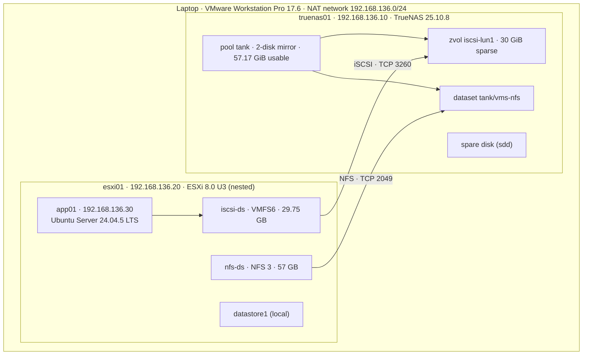
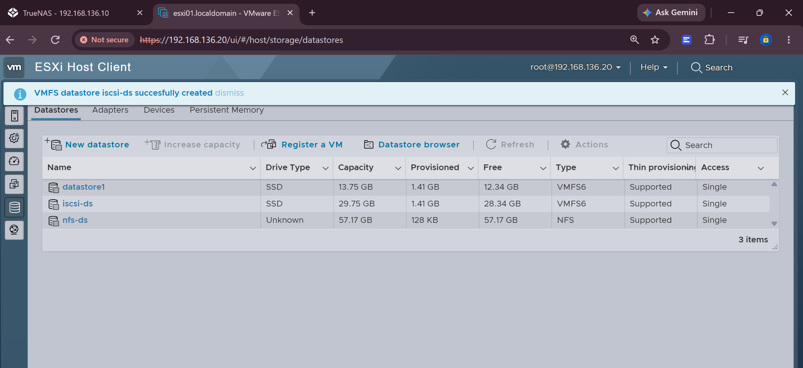
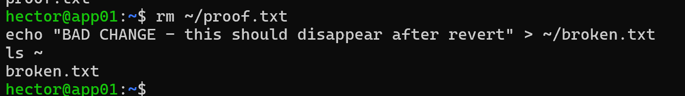
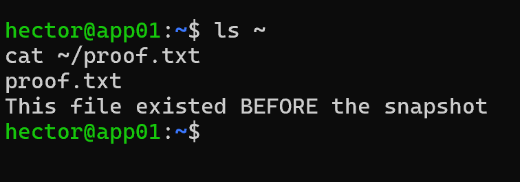
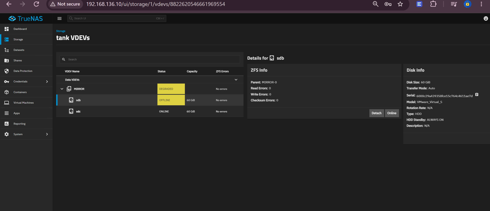
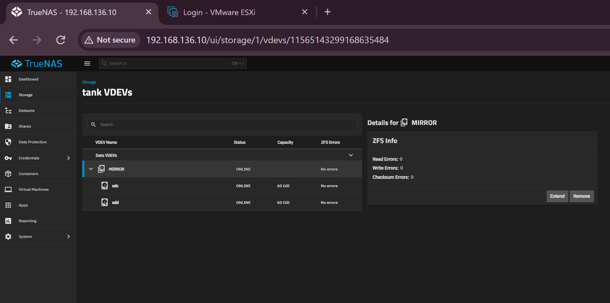

# Storage Integration Lab: iSCSI and NFS Datastores on VMware ESXi

**How I built, broke and recovered shared storage, and what I’d do for a client.**

I built this home lab in November 2026 to get hands-on with storage and VMware for an Associate Storage/Systems Engineer role. Everything runs on one laptop: a TrueNAS storage server shares storage to a VMware ESXi host over **NFS** (file) and **iSCSI** (block), and an Ubuntu server runs on that shared storage. Then I tested it on purpose: I undid a bad change with a snapshot, and I failed a disk while the server kept running.

> No passwords, keys or installers are stored in this repo. Download links for the software are below.

---

## Goals

1. Build shared storage for a VMware host
2. Connect it two ways: NFS and iSCSI
3. Survive a disk failure with no downtime
4. Undo a bad change fast

**Result: all four met.** See [Results](#results).

---

## Architecture



| Machine | IP | Software | Resources |
|---|---|---|---|
| truenas01 | 192.168.136.10 | TrueNAS Community 25.10.8 “Goldeye” | 2 vCPU · 8 GB RAM · 32 GB boot disk + three 60 GB data disks |
| esxi01 | 192.168.136.20 | VMware ESXi 8.0 Update 3e (nested in Workstation) | 4 vCPU · 10 GB RAM · 142 GB disk · VT-x/EPT passed through |
| app01 | 192.168.136.30 | Ubuntu Server 24.04.5 LTS | 2 vCPU · 2 GB RAM · 16 GB thin disk on iscsi-ds · PVSCSI · VMXNET3 |
| Gateway / DNS | 192.168.136.2 | VMware Workstation NAT | |

**Host:** Lenovo laptop, Intel Core Ultra 9 185H, 32 GB RAM, Windows 11, VMware Workstation Pro 17.6.2.



---

## How I built it

I built one layer at a time and proved each layer worked before building the next.

| Step | What I did | Proof |
|---|---|---|
| 1. Plan | IP plan, RAM sizing for a 32 GB laptop, official installers | |
| 2. ESXi | Installed nested ESXi, set a static IP, booted a test VM to prove nested virtualization works | [installed](01-esxi-installed.png) · [static IP](02-esxi-static-ip.png) · [test VM boots](07-test01-nested-boot.png) |
| 3. TrueNAS | Installed TrueNAS, set a static IP, built pool `tank` as a 2-disk mirror with a third disk kept as a spare | [dashboard](14-truenas-dashboard.png) · [static IP](17-truenas-static-ip.png) · [pool healthy](21-storage-dashboard-tank.png) |
| 4. NFS | Dataset `tank/vms-nfs`, NFS share with maproot = root, access limited to the ESXi host’s IP, mounted in ESXi as `nfs-ds` (NFS 3) | [share running](24-nfs-share-running.png) · [mounted](25-esxi-nfs-ds-mounted.png) |
| 5. iSCSI | 30 GiB sparse zvol, iSCSI target on port 3260, ESXi software iSCSI adapter with dynamic discovery, formatted as VMFS6 `iscsi-ds` | [target running](28-iscsi-running.png) · [ESXi sees the disk](29-esxi-iscsi-device.png) |
| 6. app01 | Uploaded the Ubuntu ISO to `nfs-ds`, installed app01 onto `iscsi-ds`, static IP, OpenSSH, logged in over SSH | [SSH login](41a-app01-ssh-login.png) · [disk layout](41b-app01-lsblk-df.png) |

---

## Test 1: snapshot and revert

1. Created `~/proof.txt` on app01.
2. Took an ESXi VM snapshot, `before-change` (without memory).
3. Made a bad change: deleted `proof.txt` and created `broken.txt`.
4. Restored the snapshot and powered app01 back on.

**Result: pass.** `proof.txt` was back and `broken.txt` was gone.

| After the bad change | After the restore |
|---|---|
|  |  |

**Lesson:** a snapshot is **not** a backup. It lives on the same storage as the VM, so if that storage dies, the snapshot dies too. Snapshots should be kept for days, not weeks.

---

## Test 2: disk failure with no downtime

While app01 was running on `iscsi-ds`:

- app01 ran a heartbeat: `while true; do date >> ~/alive.log; sleep 2; done`
- My laptop ran a non-stop `ping -t 192.168.136.30`

Then:

1. Took disk `sdb` **offline** in TrueNAS, simulating a dead disk. The pool went **DEGRADED**.
2. app01 kept running: **0 pings lost**, and the heartbeat had **no gaps**.
3. Replaced the failed disk with the spare `sdd`. ZFS **resilvered 6.53 GB in 13 seconds with 0 errors**.
4. The pool returned to **ONLINE**.

| During: DEGRADED | After: ONLINE |
|---|---|
|  |  |

Full `zpool status` output: [51-test2-zpool-replace-log.txt](51-test2-zpool-replace-log.txt) · [ping during the failure](48-test2-ping-during-degraded.png) · [heartbeat log](49-test2-alive-log.png)

---

## Results

| Measure | Result |
|---|---|
| Pings lost while a disk was dead | **0** |
| Gaps in app01’s 2-second heartbeat | **0** |
| Time to rebuild onto the spare | **13 s** (6.53 GB) |
| Data errors reported by ZFS | **0** |

13 seconds is only realistic for a small lab pool on SSD. On real disks holding terabytes, a rebuild can take hours, and the pool is at risk until it finishes.

---

## Problems I hit and how I fixed them

**1. TrueNAS refused to build the mirror: “duplicate serial numbers.”**
VMware Workstation’s virtual disks don’t report serial numbers. I set `disk.EnableUUID = "TRUE"` in the VM’s `.vmx` file. Linux then showed unique IDs (`lsblk`), but TrueNAS checks a different serial field and still blocked the pool. I created the pool through the TrueNAS API with the duplicate-serial override:

```
sudo midclt call -j pool.create '{"name":"tank","topology":{"data":[{"type":"MIRROR","disks":["sdb","sdc"]}]},"allow_duplicate_serials":true}'
```

That is acceptable only because these disks are virtual files on one SSD. On real hardware, I would treat that warning as a red flag (cabling or controller problems) and investigate before overriding it.
[warning](18a-serial-warning-before.png) · [error](19b-pool-error-serials.png) · [pool created](20-pool-created-cli.png)

**2. The disk replacement wouldn’t select the spare in the TrueNAS UI or API.**
The web page offered no Replace option for the offline disk, and the API returned `Disk 'sdd' not found` even after a disk re-sync. I used ZFS’s native command instead:

```
sudo zpool replace tank <offline-member-id> /dev/sdd
```

In production I’d follow the vendor’s supported procedure and open a support case if it misbehaved.

**3. ESXi showed the iSCSI disk as “Normal, Degraded.”**
There was only one network path to the storage. One failed cable or switch would cut it off. In production, the fix is **multipathing**: two or more separate paths. [screenshot](29-esxi-iscsi-device.png)

**4. TrueNAS rolled back my new static IP after 60 seconds.**
I didn’t confirm the change in time, so TrueNAS reverted it. That is a safety net against locking yourself out. On the second try I opened the new address first and confirmed from there.

**5. app01’s console stayed black after the install.**
Instead of reinstalling, I checked from Windows: `ping` answered and SSH worked, so the VM was fine and only the console display wasn’t.

---

## Lab vs. a real client

| Area | My lab | For a client (examples) |
|---|---|---|
| Storage | A TrueNAS VM on a laptop | An enterprise array (e.g. NetApp, Pure, Dell) |
| Hosts | One free ESXi host, no vCenter | A vCenter cluster: vMotion, HA, DRS |
| Network | One shared network, one path | A separate storage network with multipathing |
| Disks | One spare, failure tested by hand | Hot spares, monitoring and alerts |
| Protection | A mirror and snapshots | Backups kept in a separate place, plus replication |
| Change | Just me | Change window, runbook, as-built document |

Vendors are examples. I haven’t deployed these enterprise tools yet.

## What I’d do next

- Back up app01 to a separate place, then test a restore
- Add a second network path and set up iSCSI multipathing
- Try vCenter with two hosts (vMotion and HA)

---

## Software (official downloads, not included here)

- VMware Workstation Pro and ESXi 8.0 U3e (free downloads): https://support.broadcom.com
- TrueNAS Community Edition: https://www.truenas.com/download/
- Ubuntu Server 24.04 LTS: https://ubuntu.com/download/server

Running ESXi nested inside Workstation is not supported by Broadcom for production. It is a common way to learn.
